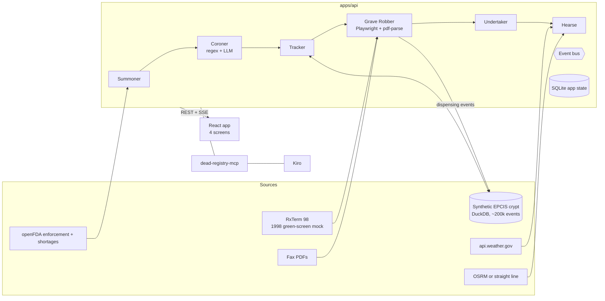

# Architecture

One Fastify API runs six organs as a pipeline. Outside systems feed it on the left; the web app reads the results over REST and one SSE stream per recall.

The highlighted bridge across the gap is the Grave Robber: it turns legacy terminal screens and faxes into the same EPCIS events the supply chain already uses.

## Pipeline events
| Event | Emitted by | Payload |
| --- | --- | --- |
| `recall.summoned` | Summoner | recallId |
| `recall.autopsied` | Coroner | recallId, needsReview |
| `recall.confirmed` | pharmacist (or Night Watch if nothing needs review) | recallId, lots |
| `trace.found` | Tracker | recallId, serials, orphans, pharmacies |
| `rpa.step` | Grave Robber | pharmacy, action, message, screen text |
| `dispense.found` | Grave Robber | recallId, patientId, serial, lot |
| `undertaker.ready` | Undertaker | recallId, quarantine, drafts |
| `hearse.planned` | Hearse | recallId, stops, distance, warnings |
| `recall.error` | any | message |
| `fill.scanned` | Soul Catcher | scan result (also sent on the recall's own stream when CURSED) |
| `fill.step` | Grave Robber | write-back step with the terminal screen |
| `fill.writeback` | Grave Robber | running, verified or failed |

SSE: `GET /api/recalls/:id/stream` (history replays on connect).

## Data
| Store | Table | Notes |
| --- | --- | --- |
| DuckDB `data/crypt.duckdb` | `events`, `parties`, view `serials` | `origin` is `epcis` (seed) or `rpa` (written by the bot) |
| SQLite `data/app.sqlite` | `recalls`, `extractions`, `dispenses`, `quarantine`, `outreach`, `routes`, `rpa_steps`, `fill_scans`, `meta` | built-in `node:sqlite` |

## API
| Method and path | Purpose |
| --- | --- |
| `GET /api/recalls`, `POST /api/recalls` | list; summon by paste or recall number |
| `GET /api/recalls/:id` | Coroner's report and stats |
| `POST /api/recalls/:id/confirm` | confirm lots and start the hunt (202) |
| `GET /api/recalls/:id/trace` | Body Trail: stages, dispenses, bot steps |
| `GET /api/recalls/:id/stream` | SSE events |
| `GET /api/afterlife` | bins, letters, shortage omen |
| `GET /api/hearse?avoid=1` | route, manifest, cold-chain warnings |
| `POST /api/outreach/:id/approve`, `PATCH /api/outreach/:id` | seal or edit a letter (never sends) |
| `POST /api/scan` | verify a GS1 element string |
| `GET /api/demo/packages`, `POST /api/demo/reset` | judge mode |
| `POST /api/night-watch/run` | poll openFDA now |
| `GET /api/trace-lot` | chain of custody for an NDC + lot |
| `GET /api/fills`, `GET /api/fills/next` | the RxTerm 98 fill queue |
| `POST /api/fills/:rx/scan` | Soul Catcher: save a scan, return the verdict (CAPTURED, WRONG_VESSEL, CURSED, DEPARTED) |
| `POST /api/fills/:rx/writeback`, `POST /api/fills/retry` | run or retry the RPA write-back |
| `GET /api/fills/scans`, `GET /api/fills/stream` | recent scans; SSE of scans and write-back steps |

## Organs
| Organ | Package | What it does |
| --- | --- | --- |
| Summoner | `packages/summoner` | openFDA client, rate limiter, fixtures, paste parsing |
| Coroner | `packages/coroner` | regex pass, LLM pass, reconcile with verbatim check |
| Tracker | `packages/tracker` + `packages/crypt-seed` | DuckDB crypt, traces, custody |
| Grave Robber | `packages/grave-robber` + `apps/rxterm98` | Playwright bot, fax parser, host allowlist |
| Undertaker | `packages/undertaker` | bins, grade-6 letters, shortage |
| Hearse | `packages/hearse` | ordering, weather, detours, cold chain |
| GS1 | `packages/gs1` | check digits, NDC <-> GTIN, element strings |

## Known limits
- Dispense rows carry no serial, so serials are inferred FIFO per pharmacy and lot and labelled as inferred.
- Fax OCR is not implemented: the demo faxes have a text layer.
- The route uses straight lines unless `OSRM_URL` is set. The OSRM path is implemented but was not run against a live OSRM server.
- The LLM pass was exercised only with test doubles. No Bedrock or Anthropic credentials were available while building.
